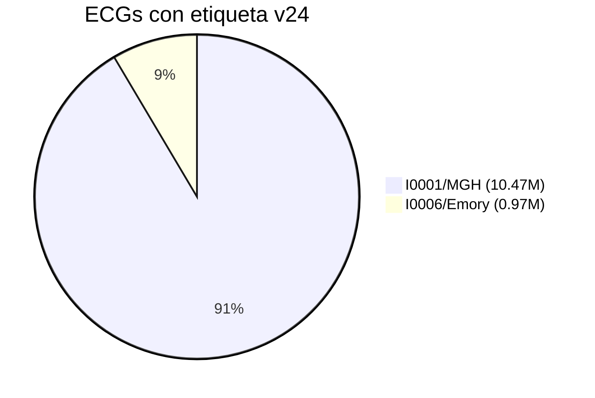

# Análisis de Arritmias HEEDB — I0001 (MGH) vs I0006 (Emory)

> Inventario de archivos/carpetas y etiquetas de arritmia anotadas en cada dataset.
> Conteos = apariciones del código (un ECG puede tener varios códigos, no son pacientes únicos).

## 1. Mapa del proyecto: imagen vs repo local

Tu captura `ECG/` corresponde a S3. En este repo es `metadatos/`:

```text
metadatos/
├── MGH/                            # ECG/I0001 en S3 — Mass General
│   ├── metadata/
│   │   ├── README
│   │   └── metadata.csv            # 3.08 GB — demografía + fechas
│   ├── 12SL_diagnoses/
│   │   ├── README
│   │   ├── diagnoses_acquisition.csv  # 1.73 GB — software + overread médico al adquirir
│   │   ├── diagnoses_dictionary.csv   # 18 KB — diccionario código -> texto
│   │   └── diagnoses_v24.csv          # 985 MB — reprocesado batch 12SL v24
│   └── ICD_codes/
│       ├── README
│       ├── icd9_codes.csv          # 2.57 GB — diagnósticos EHR por paciente-fecha
│       └── icd10_codes.csv         # 2.54 GB
└── Emory/                          # ECG/I0006 en S3 — Emory
    ├── metadata/metadata.csv       # 169 MB + README
    ├── 12SL_diagnoses/
    │   ├── diagnoses_acquisition.csv  # 101 MB
    │   ├── diagnoses_v24.csv          # 60 MB
    │   └── diagnoses_dictionary.csv + README
    └── ICD_codes/icd9_codes.csv    # 4.69 GB + icd10_codes.csv 3.12 GB + README
```

Otros: `scripts/heedb.py` (comandos `login` / `download` con `aws s3 sync`), `README.md`, `CONTRIBUTING.md`, `tests/`.

### Relaciones entre tablas

| Tabla | Clave de unión | Grano |
|---|---|---|
| `metadata.csv` | `BDSPPatientID` (paciente), `FileName` (ECG) | 1 fila = 1 ECG |
| `diagnoses_acquisition.csv` | `FileName` → `codes_software`, `codes_physician`, `jaccard_index` | 1 fila = 1 ECG |
| `diagnoses_v24.csv` | `FileName` → `codes` | 1 fila = 1 ECG |
| `diagnoses_dictionary.csv` | `codes` → `acronym`, `diagnoses` | 1 fila = 1 código (503 filas, idéntico MGH/Emory) |
| `icd9_codes.csv` / `icd10_codes.csv` | `BDSPPatientID` (+ `RECORDED_DT`) | N filas = 1 paciente-fecha-diagnóstico. **No implica que el ECG muestre la arritmia** |

### Volúmenes medidos en disco

| Dataset | metadata (README) | acquisition filas | v24 filas | ICD-9 filas | ICD-10 filas |
|---|---|---|---|---|---|
| **I0001 / MGH** | 10,608,417 ECGs / 1,818,247 pac. | 10,608,415 | 10,471,531 | 31,591,416 | 31,444,169 |
| **I0006 / Emory** | 1,061,598 ECGs / 349,548 pac. | 998,844 | 974,172 | 85,612,181 | 44,983,925 |



## 2. Diccionario 12SL: qué etiquetas existen

`diagnoses_dictionary.csv`: 503 entradas `codes,acronym,diagnoses`. No es solo arritmias, incluye:

- Ritmo (19-299): sinusales, auriculares, juncionales, ventriculares, extrasístoles, pausas, marcapasos, indeterminado.
- Conducción AV/intraventricular (100-190, 440-487): bloqueos AV, rama, fasciculares.
- Infarto (700-885), ST-T/isquemia (900-1255), hipertrofia/eje (350-575), calidad/seriales (1300-1679).

### Subset arritmia (el que se cuenta abajo)

| Grupo | Códigos (acronym) |
|---|---|
| Sinusales | 19 SRTH, 22 NSR, 21 SBRAD, 23 STACH, 24 MSBRAD, 251 SAR, 252 MSAR |
| Auriculares ectópicos | 30 LAR, 62 EAR, 64 EARO, 61 EABRAD, 63 EATACH |
| Juncionales | 267 JUNCT-R, 270 J-TACH, 34 JUNBRAD, 42 JR, 43 JTACH |
| FA / Flutter | 161 AFIB, 162 FLUT, 273 AFL, 288 AFL-BL, 171 RVR, 172 SVR |
| TSV / TA | 271 SVT, 266 SUP-TACH, 164 ATAC, 280 MULT-AT, 236 NQTACH |
| TV / FV | 272 VTACH, 277 TVT, 235 WQTACH, 248 $SVTACH, 249 $SVFIB |
| Extrasístoles | 222 PAC, 231 PVC, 223 PJC, 221 PSVC, 232 PVCF, 241 PEC, 234 BIGEM, 211 OCC, 212 FREQ, 233 CSEC |
| Escapes / pausas | 242 JESC, 243 VESC, 275 J-ESC, 276 ESCBT, 113 PAUSE |
| Bloqueos AV | 101 FAV, 103 MBZI, 104 MBZII, 105 SAV, 106 CHB, 281 COMP-HB, 107 VAVB, 108 AVDIS, 141 W2T1 |
| Marcapasos | 295 APR, 296 VPR, 297 ASVPR, 298 AVDPR, 184 VPCX |
| Indeterminado | 299 UR |

## 3. 12SL v24 — fuente recomendada (reprocesado batch)

### 3.1 I0001 / MGH v24 — 10,471,531 ECGs, 221 códigos únicos

| Categoría | Código — descripción | n | % ECGs |
|---|---|---|---|
| Normal sinus | 22 NSR | 4,115,214 | 39.3% |
| Sinus rhythm | 19 SRTH | 1,796,277 | 17.2% |
| Sinus bradicardia | 21 SBRAD | 1,138,840 | 10.9% |
| Sinus taquicardia | 23 STACH | 902,408 | 8.6% |
| Marcada bradicardia sinusal | 24 MSBRAD | 51,719 | 0.5% |
| Arritmia sinusal | 251 SAR | 333,597 | 3.2% |
| Marcada arritmia sinusal | 252 MSAR | 106,660 | 1.0% |
| **Fibrilación auricular** | **161 AFIB** | **767,742** | **7.3%** |
| Flutter auricular | 162 FLUT | 123,152 | 1.2% |
| Con RVR / con SVR | 171 RVR / 172 SVR | 252,983 / 58,402 | 2.4% / 0.6% |
| Con aberrancia | 181 ABER | 243,873 | 2.3% |
| **PVC** | **231 premature ventricular** | **1,130,305** | **10.8%** |
| **PAC** | **222 premature atrial** | **324,974** | **3.1%** |
| PSVC | 221 premature supravent. | 141,225 | 1.3% |
| Con ocasionales / frecuentes | 211 OCC / 212 FREQ | 432,974 / 164,043 | 4.1% / 1.6% |
| Ritmo juncional | 267 JUNCT-R | 387,313 | 3.7% |
| SVT | 271 supravent. tach | 29,873 | 0.3% |
| Wide QRS tach | 235 WQTACH | 129,089 | 1.2% |
| Bloqueo AV 1er grado | 101 FAV | 575,095 | 5.5% |
| Bloqueo AV variable | 107 VAVB | 81,599 | 0.8% |
| Undetermined | 299 UR | 732,518 | 7.0% |

```mermaid
bar title MGH v24 - arritmias principales (miles)
x-axis [NSR, SBRAD, STACH, AFIB, PVC, PAC, FLUT, JUNC-R, UR]
y-axis "miles de ECGs" 0 --> 4200
bar [4115, 1138, 902, 767, 1130, 324, 123, 387, 732]
```

### 3.2 I0006 / Emory v24 — 974,172 ECGs, 181 códigos únicos

| Categoría | Código | n | % ECGs |
|---|---|---|---|
| Normal sinus | 22 NSR | 493,537 | 50.7% |
| Sinus rhythm | 19 | 120,391 | 12.4% |
| Sinus bradicardia | 21 | 141,581 | 14.5% |
| Sinus taquicardia | 23 | 76,273 | 7.8% |
| Arritmia sinusal | 251 / 252 | 40,186 / 11,059 | 4.1% / 1.1% |
| **Fibrilación auricular** | **161** | **60,133** | **6.2%** |
| Flutter | 162 | 12,905 | 1.3% |
| RVR / SVR | 171 / 172 | 19,440 / 4,492 | 2.0% / 0.5% |
| **PVC** | **231** | **52,277** | **5.4%** |
| **PAC** | **222** | **35,678** | **3.7%** |
| PSVC | 221 | 12,108 | 1.2% |
| OCC / FREQ | 211 / 212 | 38,509 / 15,798 | 4.0% / 1.6% |
| Ritmo juncional | 267 | 7,789 | 0.8% |
| Bloqueo AV 1er grado | 101 | 68,601 | 7.0% |
| Undetermined | 299 | 8,850 | 0.9% |

```mermaid
bar title Emory v24 - arritmias principales (miles)
x-axis [NSR, SBRAD, STACH, AFIB, PVC, PAC, FLUT, JUNC-R, UR]
y-axis "miles de ECGs" 0 --> 500
bar [493, 141, 76, 60, 52, 35, 12, 7, 8]
```

> Lectura: prevalencia muy similar. NSR ~40-50%, bradicardia ~11-15%, FA ~6-7%, PVC 5-11%, flutter ~1.2%.

## 4. Acquisition: software vs overread médico

Misma taxonomía, distinta práctica. Emory conserva ritmo; **MGH-acquisition está dominado por sentencias seriales** (`446, 1301 COMPAR, 1300 NO-SERIAL, 1305 NO-CHG`) — no usar para prevalencia, usar v24.

| Dataset | AFIB 161 soft / phys | PVC 231 soft / phys | SBRAD 21 soft / phys | STACH 23 soft / phys |
|---|---|---|---|---|
| MGH (10.6M) | 1,156,272 / 929,074 | 831,431 / 575,399 | 1,191,131 / 987,640 | 977,962 / 803,557 |
| Emory (998k) | 83,128 / 88,364 | 68,098 / 65,195 | 134,810 / 135,308 | 78,319 / 76,132 |

Columna `jaccard_index` = acuerdo software-médico por ECG.

## 5. ICD — arritmias y trastornos de conducción (EHR, no ECG)

### 5.1 ICD-9: 426 (conducción) + 427 (arritmia)

| Código — descripción | MGH n | Emory n |
|---|---|---|
| 427.31 Fibrilación auricular | 670,752 | 1,248,205 |
| 427.32 Flutter auricular | 58,775 | 146,705 |
| 427.1 TV paroxística | 55,450 | 144,226 |
| 427.0 TSV paroxística | 19,672 | 71,515 |
| 427.41 FV / 427.42 Flutter vent. | 3,839 / 264 | 12,101 / 724 |
| 427.81 Sick-sinus | 33,931 | 120,899 |
| 427.9 Disritmia NE | 265,344 | 114,752 |
| 427.89 Otras especificadas | 104,167 | 181,187 |
| 426.0 Bloqueo AV completo | 20,649 | 48,069 |
| **Total 426/427** | **1,356,332 (4.3% de 31.59M)** | **2,350,877 (2.7% de 85.61M)** |

### 5.2 ICD-10: I44-I49

| Código — descripción | MGH n | Emory n |
|---|---|---|
| I48.0 FA parox / I48.91 FA NE | 295,467 / 218,593 | 198,298 / 388,000 |
| I48.2 FA crónica / I48.1 persistente | ~71k / ~14k | 73,086 / 31,925 |
| I48.92 Flutter NE / I48.3 típico | 33,842 / 17,793 | 49,402 / 8,476 |
| I47.1 TSV / I47.2 TV | 61,377 / ~56k | 49,350 / 54,038 |
| I49.3 Extras vent / I49.1 Extras auric | 37,377 / 6,053 | 34,962 / 9,686 |
| I49.5 Sick-sinus | 33,513 | 32,768 |
| I44.2 Bloqueo AV completo | 20,821 | 20,349 |
| **Total I44-I49** | **1,344,511 (4.3% de 31.44M)** | **1,185,364 (2.6% de 44.98M)** |

```mermaid
bar title ICD arritmia - FA domina (miles)
x-axis [MGH-427.31, Emory-427.31, MGH-I48.0, Emory-I48.91]
y-axis "miles de registros" 0 --> 1300
bar [670, 1248, 295, 388]
```

> Nota Emory ICD-9: `DIAGNOSIS_ICD9_DESC='Not Recorded'` frecuente — agrupar por código, no por texto.

## 6. Cómo responder “qué arritmias y cuántos registros”

- Para ML por ECG: usa `diagnoses_v24.csv` + `diagnoses_dictionary.csv` (sección 3).
- Para acuerdo humano-máquina: `diagnoses_acquisition.csv` (`codes_software` vs `codes_physician`, sección 4).
- Para comorbilidad por paciente: `icd9/icd10` filtrando `427*` / `I44-I49` (sección 5), uniendo por `BDSPPatientID` y conservando hospital.
- No mezclar hospitales al cruzar tablas.

*Generado por conteo directo streaming de los 12 CSV locales. Conteos verificados con `csv.DictReader`.*
